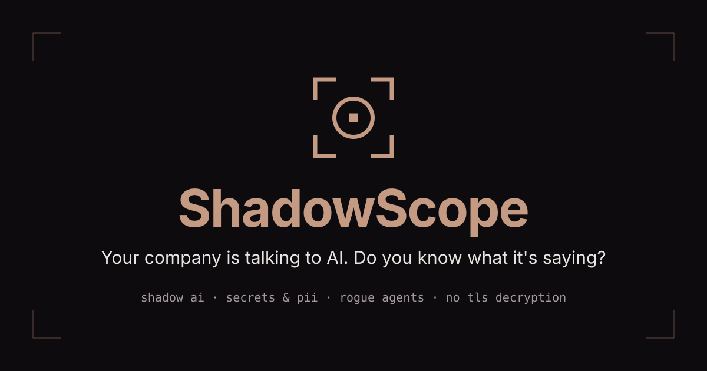
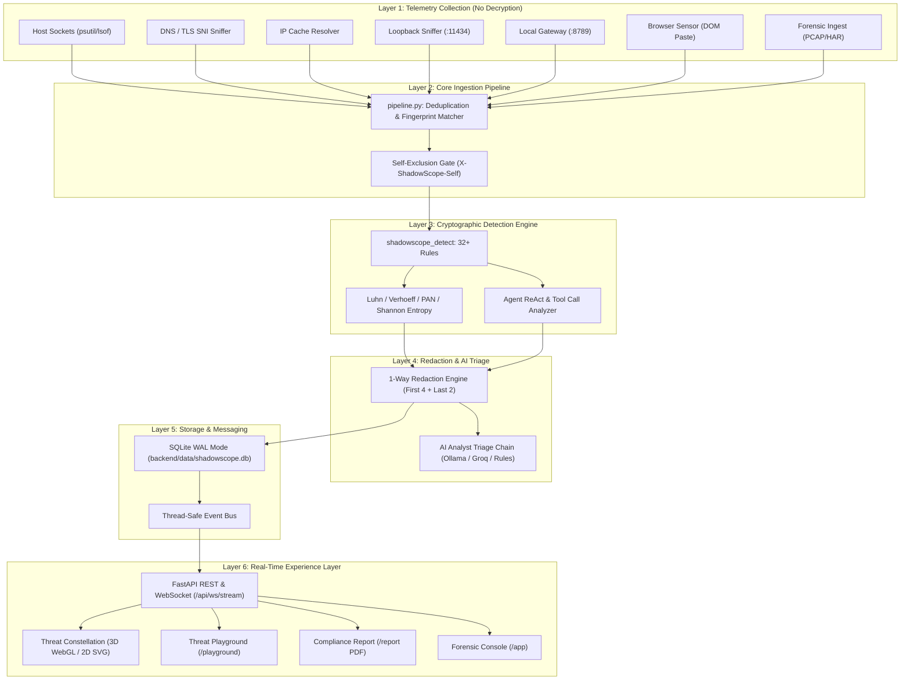

# 🚀 CBIT Hacktoberfest '26 — Project Submission

> **Official Public Repository for CBIT Hacktoberfest '26**  
> *Chaitanya Bharathi Institute of Technology (CBIT), Hyderabad*

---

## 📋 Team Information

| Attribute | Details |
| :--- | :--- |
| **Team Name** | **git push n pray** |
| **Team Number** | `TEAM-10` (`HFT26-TEAM-10`) |
| **Registration ID** | `HFEST26-4KLZUH37` |
| **Problem Track** | **AI Shadow IT & Agentic Data Exfiltration Scanner** |
| **Domain** | `Cybersecurity & Enterprise AI Governance` |
| **Team Leader** | Pritika Agarwal (pritikaagarwal0731@gmail.com) |
| **Institution** | CBIT Hyderabad |

### 👥 Team Members

| # | Member | GitHub | Email | Role |
| :- | :--- | :--- | :--- | :--- |
| 0 | **Pritika Agarwal** (Lead) | [@31Pritika](https://github.com/31Pritika) | pritikaagarwal0731@gmail.com | **Part D**: Experience Layer, 3D Constellation & Visual Design |
| 1 | **Vishwak Boddukuri** | [@vishwak-b](https://github.com/vishwak-b) | vishwak.boddukuri@gmail.com | **Part A**: Core Engine, Packet Pipeline & OS Collectors |
| 2 | **Kevin Tejas** | [@kevin-tejas](https://github.com/kevin-tejas) | kevintejas07@gmail.com | **Part C**: Dashboard Console, Live Telemetry & AI Analyst UX |
| 3 | **Aaraadhyaa Reddy** | [@aaraadhyaa-r](https://github.com/aaraadhyaa-r) | vanamakraken07@gmail.com | **Part B**: Detection Intelligence, Attack Simulator & Sensor Extension |

---

<p align="center">
  
</p>

# 🛡️ ShadowScope

> **See every AI your company talks to — without breaking TLS.**  
> *A privacy-first passive scanner for AI Shadow IT, unencrypted prompt leaks, and rogue autonomous agent exfiltration.*

[](https://github.com/31Pritika/HFT26-TEAM-10)
[](https://python.org)
[](https://fastapi.tiangolo.com)
[](https://react.dev)
[](LICENSE)

---

## 🎯 Problem Statement

Enterprise employees and engineering teams are integrating Generative AI at unprecedented speed: pasting code into ChatGPT, configuring CLI coding agents (Cursor, Claude Code, Aider, LangChain), and spinning up local workstation LLMs (Ollama, LM Studio).

Existing security solutions fail catastrophically:
1. **Traditional SSL Decryption (MITM Proxies) Breaks Developer Tools**: Installing corporate root CAs to decrypt packets triggers TLS handshake errors in CLI tools (`curl`, `gh`, Python `requests`, Ollama, IDE plugins) due to hardcoded certificate pinning.
2. **Massive Privacy & Regulatory Liability**: Indiscriminate decryption proxies inspect and record personal employee banking, passwords, and healthcare correspondence.
3. **Completely Blind to Localhost AI**: Desktop LLMs running over `127.0.0.1:11434` never traverse corporate network perimeters.
4. **Autonomous Agent Chaos**: Multi-step AI agents possess shell execution, filesystem write, and network permissions, allowing them to autonomously read SSH keys, dump environment variables, and exfiltrate databases at machine speed.

**ShadowScope** solves this without breaking TLS. By fusing passive OS process socket mappings, unencrypted TLS ClientHello SNI headers, loopback HTTP sniffers, and DOM pre-flight sensors, ShadowScope delivers complete enterprise visibility with mathematical zero-knowledge privacy.

---

## ✨ Key Features

- **🌐 Passive Zero-Decryption Network Discovery**: Correlates OS process sockets (`psutil`/`lsof`) with unencrypted TLS SNI headers and DNS queries. Sees every destination without certificate tampering.
- **⚡ High-Throughput Detection Engine (`shadowscope_detect`)**: Pure Python engine scanning at **5.5 MB/s** across 32+ vulnerability heuristics:
  - **Secrets**: AWS IAM/Secret keys, OpenAI (`sk-...`), Anthropic (`sk-ant-...`), GitHub PATs, GCP service accounts, database connection URIs, private keys (PEM/RSA), Stripe, Slack, and generic high-entropy strings.
  - **Personal Data (PII)**: Aadhaar (Verhoeff checksum), Credit Cards (Luhn + RuPay IIN), PAN (4th character validation), Indian Phone (+91), UPI VPAs, GSTIN, US SSN, and bulk PII volume triggers.
  - **Proprietary Code**: Detects source code files (Python, JS, Java, SQL, C) and confidentiality markers.
- **🤖 Autonomous Agent Loop Interception**: Parses OpenAI, Anthropic, Ollama, LangChain ReAct, and AutoGPT tool calls. Detects dangerous shell commands (`rm -rf`, `curl | bash`, `dd`), sensitive file reads (`~/.ssh/id_rsa`, `/etc/shadow`), and assigns an automated Autonomy Score (0–100%).
- **🔒 Air-Gapped LLM Triage Chain with Privacy Proof**: Multi-tiered AI analyst (Featherless → Groq → local Ollama `llama3.2:3b` → deterministic rules). A triple-pass redaction re-scan guarantees **zero raw secrets ever leave the host machine**.
- **🌌 3D Threat Constellation (`/app/graph`)**: Interactive WebGL orbital topology powered by Three.js and `react-force-graph-3d`, displaying real-time egress particles flowing toward AI providers with risk-coded glowing geometry and a 2D SVG fallback.
- **🧪 Threat Playground (`/playground`)**: Dual-pane browser scanner with real-time character-morphing redaction view, India-specific test presets, and a simulated "Send to ChatGPT" packet flight with scope-ring interception shockwaves.
- **📋 One-Click Regulatory Compliance Reports (`/report`)**: Executive cover letter grade (A–F) and scorecards for **India DPDP Act 2023**, **EU GDPR**, **AICPA SOC 2**, **PCI-DSS v4.0**, and **ISO/IEC 27001:2022** with a dedicated `@media print` white-paper stylesheet.
- **🧩 Shadow Sensor Browser Extension (`extension/`)**: Manifest V3 extension for Chrome and Edge that detects and alerts on sensitive pastes in web AI interfaces prior to DOM submission.

---

## 🏗️ Architecture & Pipeline Flow



---

## 🔍 How We See Traffic Without SSL Decryption

| Collector | Target Telemetry | Inspection Mechanism | Privilege Level |
| :--- | :--- | :--- | :--- |
| **`process_conn`** | Process identity & remote destination | Scans OS active socket tables via `psutil` (fallback to `lsof`) every 2 seconds. Correlates PID, process name, and executable path to AI endpoint IP addresses. | Standard User (own processes) or Root/Admin (all) |
| **`ip_cache`** | Destination IP → AI Provider mapping | Actively resolves the 30+ canonical AI provider hostnames and wildcards every 5 minutes into an in-memory routing table. | None (standard DNS) |
| **`dns_sni`** | Domain names of outbound connections | Passively inspects plaintext DNS queries and the **Server Name Indication (SNI)** field in the unencrypted TLS ClientHello handshake packet. | Promiscuous / Sudo / Npcap |
| **`loopback`** | Full prompts sent to local workstation LLMs | Reassembles unencrypted plain HTTP streams on loopback (`127.0.0.1`) ports 11434 (Ollama), 1234 (LM Studio), and 8788. | Sudo / Npcap (or Gateway) |
| **`gateway`** | Full prompt payload & real-time blocking | Optional streaming reverse proxy on `http://127.0.0.1:8789`. Developer scripts point `base_url` here. Returns HTTP 403 on critical leaks. | None (standard user port) |
| **`extension`** | Web chat inputs (ChatGPT, Claude, Gemini) | Shadow Sensor browser extension intercepts DOM paste and form submit events in the browser before TLS encryption occurs. | Browser Extension (DOM API) |

---

## 📸 Visual Walkthrough & Screenshots

> *Forensic telemetry visual assets are stored in [`docs/media/`](docs/media/).*

| Feature | Preview | Description |
| :--- | :---: | :--- |
| **3D Threat Constellation** | `docs/media/constellation_3d.png` | Orbital WebGL network graph showing processes communicating with AI cloud providers, directional egress particles, and slide-over threat inspection. |
| **Threat Playground** | `docs/media/threat_playground.png` | Dual-pane live pattern scanner with instant character-morphing redaction, India customer PII presets, and simulated interceptor shockwaves. |
| **Regulatory Compliance Report** | `docs/media/compliance_report_pdf.png` | Executive posture scorecard with animated grade ring, DPDP/GDPR/SOC2 control audits, and high-contrast `@media print` PDF layout. |
| **Live Traffic Console** | `docs/media/live_traffic_telemetry.png` | Streaming telemetry feed with buffered backpressure controls, inspection drawer, and live PID lineage. |
| **Ask AI Analyst Triage** | `docs/media/ai_analyst_triage.png` | Automated investigation revealing LLM reasoning, false-positive verification, and verifiable token redaction proof. |

---

## 💻 Tech Stack

- **Backend & Core Engine**: Python 3.11+, FastAPI, Uvicorn, SQLite (WAL mode), Pydantic v2, Scapy, `psutil`, `httpx`
- **Detection Intelligence**: `shadowscope_detect` (pure Python stdlib + httpx, 1461+ tests, zero external binary dependencies)
- **Frontend Console**: React 19, TypeScript, Vite, Tailwind CSS, Motion (`motion/react`), Three.js, React Three Fiber, `react-force-graph-3d`, Lucide Icons, Recharts, Lenis
- **Browser Extension**: Manifest V3, WebExtensions API, Embedded JavaScript Scanner
- **Testing & Forensics**: `pytest`, `pytest-asyncio`, Scapy PCAP reassembly, DevTools HAR parser

---

## 🚀 Setup & Installation Guide

### Prerequisites
- **Python 3.11+** installed and available on PATH (`python3 --version` or `python --version`)
- **Node.js 18+** & `npm` installed (`node --version`)
- *(Optional)* **Ollama** for local air-gapped LLM triage: `ollama run llama3.2:3b`
- *(Optional on Windows)* **Npcap** in WinPcap API-compatible mode for packet capture

---

### macOS & Linux Setup

```bash
# 1. Clone repository
git clone https://github.com/31Pritika/HFT26-TEAM-10.git
cd HFT26-TEAM-10

# 2. Automated start script (creates venv, installs dependencies, launches backend & web UI)
./scripts/start.sh

# 3. (Optional) Run with packet capture permissions
sudo ./scripts/start.sh --sudo

# 4. (Optional) Run reachable across local network
./scripts/start.sh --host
```

---

### Windows Setup

```powershell
# 1. Clone repository
git clone https://github.com/31Pritika/HFT26-TEAM-10.git
cd HFT26-TEAM-10

# 2. Run PowerShell start script
powershell -ExecutionPolicy Bypass -File scripts\start.ps1

# 3. (Optional) Allow LAN devices to connect
powershell -ExecutionPolicy Bypass -File scripts\start.ps1 -BindHost 0.0.0.0
```

*The application will automatically open at **`http://localhost:5173`** with the backend engine running on **`http://localhost:8787`**.*

---

### Environment Variables (`.env`)

Configure optional integrations in a root `.env` file:

```bash
# Cloud / Demo Mode
SHADOWSCOPE_CLOUD=0            # Set to 1 for public read-only deployments
VITE_DEMO_MODE=false           # Force frontend to use canned contracts

# LLM Triage Engines (Optional — fallback deterministic rules work 100% offline)
OLLAMA_URL=http://localhost:11434
OLLAMA_MODEL=llama3.2:3b
GROQ_API_KEY=gsk_...
FEATHERLESS_API_KEY=...
FEATHERLESS_MODEL=...

# Gateway & Networking
SHADOWSCOPE_GATEWAY_PORT=8789
SHADOWSCOPE_CORS_ORIGINS=http://localhost:5173
```

---

### Loading the Shadow Sensor Browser Extension

1. Open **Google Chrome** or **Microsoft Edge**.
2. Navigate to `chrome://extensions` (or `edge://extensions`).
3. Toggle **Developer mode** on (top-right corner).
4. Click **Load unpacked** and select the [`extension/`](extension/) directory from this repository.
5. The Shadow Sensor scope icon will appear in your browser toolbar, passively protecting ChatGPT, Claude, and Gemini sessions.

---

### Running the Automated Attack Simulation Demo

With the backend running, trigger the automated 9-scenario attack sequence from a separate terminal:

```bash
# macOS / Linux
./scripts/demo.sh

# Windows
powershell -ExecutionPolicy Bypass -File scripts\demo.ps1
```

*Watch real-time credential leaks, rogue agent shell spawns, and gateway blocks stream across the dashboard.*

---

## ☁️ Demo-Mode & Cloud Deployment

For public, zero-maintenance hackathon judging, ShadowScope includes a dedicated **Cloud Mode** (`SHADOWSCOPE_CLOUD=1`):
- Disables packet sniffers and local subprocesses.
- Serves seeded demonstration databases with full forensic query fidelity.
- Locks administrative policy resets and restricts uploads to 5 MB.
- Deployable via the included [`Dockerfile`](Dockerfile) and [`render.yaml`](render.yaml).

---

## 🛠️ Contribution & Submission Workflow

All teams must follow the official fork-and-pull-request workflow:

1. **Fork this Repository**:
   - One team member should click the **Fork** button at the top right to fork this upstream repository to your personal/team GitHub account.
2. **Add Collaborators**:
   - In your forked repository, navigate to **Settings > Collaborators** and invite all your registered team members.
3. **Clone & Develop Locally**:
   ```bash
   git clone https://github.com/<your-username>/HFT26-TEAM-10.git
   cd HFT26-TEAM-10
   git checkout -b feature/prototype
   ```
4. **Commit & Push Regularly**:
   - Make atomic, descriptive commits throughout the hackathon.
   ```bash
   git add .
   git commit -m "feat: implement core solution architecture"
   git push origin feature/prototype
   ```
5. **Open Pull Request (PR) for Final Submission**:
   - When ready for evaluation, open a **Pull Request** from your fork's `main` branch back to this upstream repository's `main` branch.
   - **PR Title Format**: `[SUBMISSION] TEAM-10 - git push n pray - AI Shadow IT & Agentic Data Exfiltration Scanner`
   - **PR Description Checklist**:
     - 📌 Solution Overview & Approach
     - 🏗️ Architecture & Tech Stack Details
     - 🚀 Local Setup & Installation Instructions
     - 🎥 Demo Video Link / Live Deployment URL
     - 📸 Key Screenshots & Visuals

---

## ⚠️ Important Rules & Code of Conduct
* **Upstream Protection**: Do not push directly to this repository's main branch. All evaluation will be conducted on your submitted Pull Request.
* **Original Work**: All code submitted must be developed during the hackathon timeline. Open-source libraries and frameworks are welcomed with proper attribution.
* **Code Freeze**: Final Pull Requests must be submitted before the designated hackathon submission deadline.

---

## 📄 License

This project is licensed under the **MIT License** — see the [LICENSE](LICENSE) file for details. Built with pride by Team **git push n pray** for **CBIT Hacktoberfest '26**.
